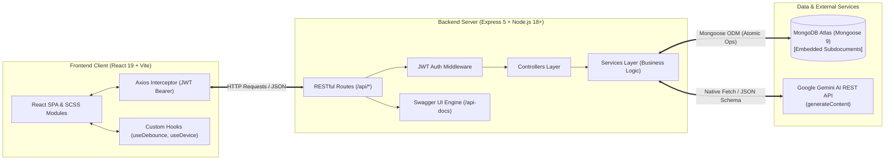
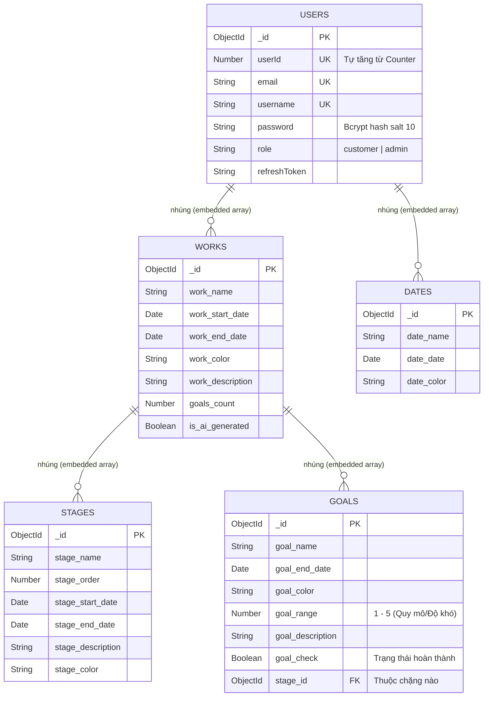
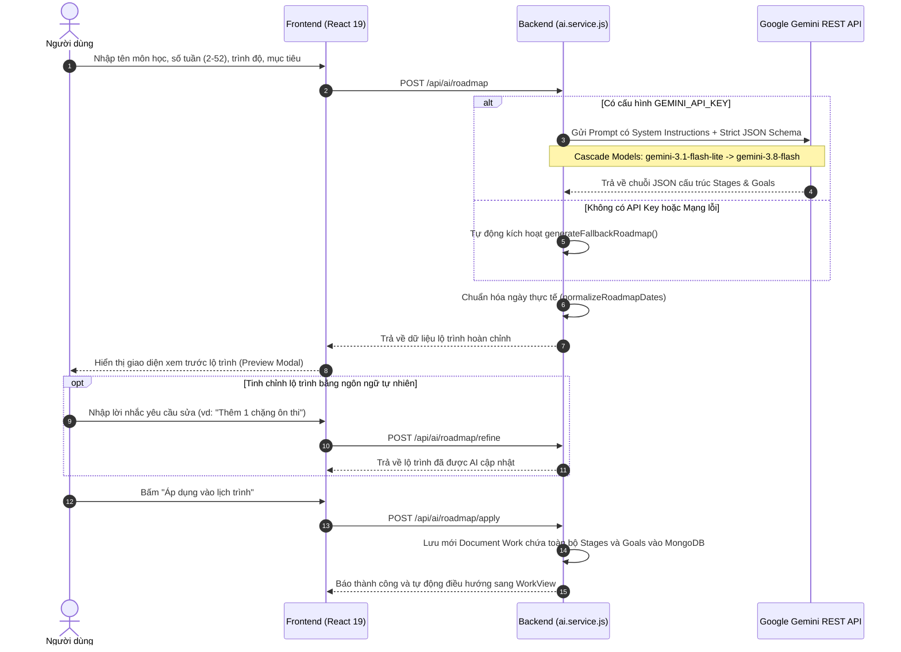

# 📅 Ứng Dụng Quản Lý Lịch Trình, Đầu Việc & Lộ Trình Học Tập Thông Minh

<p align="center">
  
  
  
  
  
  
  
  
</p>

Ứng dụng web toàn diện hỗ trợ quản lý công việc, phân chia chặng mục tiêu (Roadmap Milestones), theo dõi hạn chót và lịch trình cá nhân hóa. Dự án được xây dựng theo kiến trúc **MERN Stack** (MongoDB, Express.js, React 19, Node.js), sử dụng **mô hình Embedded Documents trong MongoDB** để tối ưu hóa hiệu năng truy vấn nguyên tử và tích hợp **Google Gemini AI** tự động phân tích và sinh lộ trình học tập thông minh.

---

## 🔗 Liên Kết Trực Tiếp (Live Deployment & API Documentation)

- 🌐 **Website ứng dụng (Live URL):** [https://csbu-109.vercel.app](https://csbu-109.vercel.app)
- 📖 **Tài liệu API trực tuyến (Swagger UI):** [https://csbu109.onrender.com/api-docs](https://csbu109.onrender.com/api-docs) *(hoặc `http://localhost:5000/api-docs` khi chạy tại local)*
- 📄 **Đặc tả OpenAPI JSON:** [https://csbu109.onrender.com/api-docs.json](https://csbu109.onrender.com/api-docs.json)
- 🔌 **API Base URL công khai:** `https://csbu109.onrender.com/api`

---

## 📸 Hình Ảnh Giao Diện (Screenshots & Layout Preview)

Ứng dụng được thiết kế tối ưu cho trải nghiệm người dùng với bố cục trực quan:

| Màn hình | Mô tả trải nghiệm |
| :--- | :--- |
| **Bảng điều khiển (Dashboard View)** | Trung tâm điều phối hiển thị nhanh 5 mục tiêu khẩn cấp nhất, các ngày kỷ niệm sắp tới và thanh tiến độ tổng thể. Có thể đánh dấu hoàn thành nhanh mục tiêu ngay tại đây. |
| **Quản lý Đầu việc & Chặng (Work Split-View)** | Bố cục 2 cột cân đối: Danh sách việc bên trái (hỗ trợ tìm kiếm Debounce 300ms, lọc trạng thái) và Khung chi tiết chặng Roadmap Accordion bên phải với các thẻ task phong cách Kanban. |
| **Lịch sự kiện & Ngày kỷ niệm (Calendar View)** | Lưới lịch tháng chuẩn ISO 7 cột trực quan, cho phép tô màu, đếm ngược các mốc thi cử, sự kiện quan trọng. |
| **Hộp thoại Gemini AI Roadmap** | Hộp thoại tương tác tạo lộ trình thông minh từ 2 - 52 tuần, cho phép tinh chỉnh bằng ngôn ngữ tự nhiên trước khi lưu vào dữ liệu. |

> *Ghi chú: Hình ảnh giao diện chi tiết có thể được tham khảo và cập nhật trong thư mục [`docs/screenshots/`](file:///c:/Users/khang/.vscode/CSBU109-Assignments/docs/screenshots/).*

---

## 🏛 Kiến Trúc Hệ Thống (System Architecture)

Hệ thống được tổ chức theo mô hình **Client - Server (Decoupled Architecture)** giao tiếp thông qua giao thức chuẩn RESTful API và JWT Authentication:



### Luồng giao tiếp nội bộ:
1. **Client-Side:** Ứng dụng Single Page Application (SPA) viết bằng JavaScript thuần và React 19. Toàn bộ CSS được đóng gói dạng **SCSS Modules (`.module.scss`)** giúp cô lập style, tránh xung đột CSS toàn cục. Mọi tương tác dữ liệu đều đi qua lớp API services tập trung (`src/shared/services/`).
2. **Server-Side:** Kiến trúc phân lớp sạch (Clean Architecture):
   - `routes/`: Định tuyến các endpoint.
   - `middlewares/`: Kiểm tra tính hợp lệ của JWT token, giải mã thông tin tài khoản và gán vào `req.user`.
   - `controllers/`: Nhận HTTP request, kiểm tra đầu vào, gọi service và trả về HTTP response chuẩn mực.
   - `services/`: Xử lý logic tính toán, thuật toán ngày tháng, thao tác với database và tích hợp trí tuệ nhân tạo.
3. **Bảo mật:** Sử dụng cơ chế token kép: **Access Token** ngắn hạn gửi qua header `Authorization: Bearer <token>` và **Refresh Token** dài hạn lưu trong cơ sở dữ liệu để tự động làm mới phiên làm việc.

---

## 🗄 Thiết Kế Cơ Sở Dữ Liệu (Database Design)

Thay vì thiết kế cơ sở dữ liệu quan hệ (RDBMS) phân mảnh nhiều bảng phải `JOIN` phức tạp, hệ thống áp dụng triệt để sức mạnh của **Document-oriented NoSQL** với mô hình **Embedded Subdocuments**:



### Lợi ích kỹ thuật của mô hình nhúng trong dự án:
- **Tính nguyên tử (Atomicity):** Khi người dùng xóa một đầu việc lớn (`Work`), toàn bộ các chặng (`Stages`) và mục tiêu con (`Goals`) bên trong nó được dọn dẹp sạch sẽ chỉ bằng một lệnh `$pull` duy nhất mà không lo để lại bản ghi mồ côi (orphaned data).
- **Triệt tiêu lỗ hổng IDOR (Data Isolation by Design):** Toàn bộ dữ liệu của một tài khoản nằm trọn vẹn trong Document của người đó. Mọi truy vấn database đều neo chặt vào `req.user._id` (`User.findById(req.user._id)`), loại bỏ hoàn toàn khả năng người dùng này đọc hoặc sửa nhầm dữ liệu của người dùng khác.
- **Tốc độ đọc vượt trội:** Khi mở trang chi tiết một công việc, hệ thống chỉ cần 1 truy vấn MongoDB để nạp toàn bộ cấu trúc chặng và mục tiêu thay vì phải truy vấn 3-4 bảng khác nhau.

---

## ⚡ Tính Năng & Kỹ Thuật Triển Khai Nổi Bật (Technical Highlights)

- ⚡ **Cập nhật giao diện tức thì (Optimistic UI):**
  - Khi người dùng tích chọn hoàn thành mục tiêu, React State lập tức cập nhật checkbox và thanh tiến độ % mà không cần chờ đợi round-trip từ máy chủ Backend.
  - Request API (`PATCH /api/works/:work_id/goals/:goal_id/check`) được gửi ngầm. Nếu xảy ra sự cố mạng hoặc máy chủ trả về lỗi, hệ thống sẽ tự động hoàn tác (rollback) trạng thái checkbox về trước đó kèm thông báo cảnh báo cho người dùng.
- 🔍 **Tìm kiếm thông minh với Debounce 300ms:**
  - Tích hợp custom hook `useDebounce` trong ô tìm kiếm đầu việc. Khi người dùng gõ liên tục, hệ thống sẽ hoãn việc lọc danh sách cho đến khi người dùng ngừng gõ 300ms, giúp giảm thiểu tối đa hiện tượng giật lag và re-render thừa.
- 🪜 **Thuật toán tự động phân bổ mục tiêu vào chặng (`autoAssignGoals`):**
  - Người dùng có thể tạo danh sách mục tiêu tự do trước, sau đó tạo chặng thì hệ thống sẽ tự động phân bổ. Backend sẽ duyệt qua deadline của từng mục tiêu, so khớp với khoảng `[stage_start_date, stage_end_date]` của từng chặng để tự động gán `stage_id` chính xác nhất.
- 📊 **Bố cục Split-View cân đối & Lazy Fetching:**
  - Cột danh sách đầu việc và cột chi tiết chặng được thiết kế đồng bộ chiều cao theo chuẩn Dashboard hiện đại, cuộn độc lập.
  - Áp dụng cơ chế **Lazy-fetching**: Trang danh sách chỉ nạp thông tin tổng quan của Works. Khi người dùng click vào một Work cụ thể, chi tiết các Goals và Stages mới được nạp, giúp tối ưu băng thông mạng.
- 🔐 **Bảo mật đa lớp:**
  - Băm mật khẩu người dùng bằng thư viện `bcryptjs` với salt rounds = 10 trước khi lưu vào MongoDB.
  - Xác thực phiên làm việc qua JWT Token được kiểm tra nghiêm ngặt tại middleware `auth.middleware.js`.

---

## 🤖 Luồng Hoạt Động Của Trí Tuệ Nhân Tạo (Gemini AI Workflow)

Tính năng **AI Sinh Lộ trình Học tập Thông minh** là điểm nhấn kỹ thuật quan trọng của hệ thống:



- **Prompt Engineering & Định dạng đầu ra:** Ép kiểu phản hồi từ Gemini API về định dạng JSON nghiêm ngặt (`responseMimeType: 'application/json'`) để tránh việc AI trả về văn bản tự do không parse được.
- **Bộ tạo dự phòng độc lập (Graceful Fallback):** Nếu máy chủ chưa cấu hình `GEMINI_API_KEY` hoặc gặp sự cố quota, hàm `generateFallbackRoadmap()` dựa trên cây thuật toán phân chia chặng có sẵn sẽ được kích hoạt tức thì, đảm bảo ứng dụng không bao giờ bị gián đoạn hoạt động.

---

## 📖 Danh Mục RESTful API & Tài Liệu Swagger UI

Toàn bộ hệ thống Backend cung cấp **16+ RESTful API endpoints** được chuẩn hóa và kiểm thử:

### 1. Bảng tóm tắt các Endpoints chính:

| Nhóm nghiệp vụ | Method | Endpoint URL | Xác thực | Mô tả chức năng |
| :--- | :---: | :--- | :---: | :--- |
| **Xác thực** | `POST` | `/api/auth/register` | Public | Đăng ký tài khoản mới, sinh `userId` tự tăng |
| | `POST` | `/api/auth/login` | Public | Đăng nhập hệ thống, cấp Access & Refresh Token |
| | `POST` | `/api/auth/refresh` | Public | Làm mới Access Token khi hết hạn |
| | `POST` | `/api/auth/logout` | Bearer | Đăng xuất, hủy Refresh Token trong database |
| | `GET` | `/api/auth/me` | Bearer | Lấy thông tin tài khoản người dùng hiện tại |
| **Bảng điều khiển** | `GET` | `/api/dashboard` | Bearer | Lấy 5 mục tiêu khẩn cấp nhất & 3 sự kiện sắp tới |
| **Đầu việc (Works)**| `POST` | `/api/works` | Bearer | Tạo đầu việc mới |
| | `GET` | `/api/works` | Bearer | Lấy danh sách đầu việc vắn tắt (hỗ trợ `?search=`) |
| | `PUT` | `/api/works/:work_id` | Bearer | Cập nhật thông tin đầu việc |
| | `DELETE`| `/api/works/:work_id` | Bearer | Xóa nguyên tử đầu việc cùng toàn bộ chặng & mục tiêu con |
| **Mục tiêu (Goals)**| `POST` | `/api/works/:work_id/goals` | Bearer | Thêm mục tiêu con vào đầu việc |
| | `GET` | `/api/works/:work_id/goals` | Bearer | Tải chi tiết chặng và mục tiêu của một Work (Lazy Fetching) |
| | `PUT` | `/api/works/:work_id/goals/:goal_id` | Bearer | Cập nhật tên, deadline, độ ưu tiên, quy mô mục tiêu |
| | `PATCH` | `/api/works/:work_id/goals/:goal_id/check` | Bearer | Đảo ngược trạng thái hoàn thành (Optimistic UI) |
| | `DELETE`| `/api/works/:work_id/goals/:goal_id` | Bearer | Xóa mục tiêu con |
| **Chặng (Stages)** | `POST` | `/api/works/:work_id/stages` | Bearer | Tạo chặng lộ trình mới |
| | `PUT` | `/api/works/:work_id/stages/:stage_id` | Bearer | Sửa thông tin chặng, ngày bắt đầu và kết thúc |
| | `DELETE`| `/api/works/:work_id/stages/:stage_id` | Bearer | Xóa chặng (các mục tiêu con tự động chuyển về tự do) |
| | `POST` | `/api/works/:work_id/stages/auto-assign` | Bearer | Thuật toán tự động gom mục tiêu vào chặng theo deadline |
| **Lịch ngày nhớ** | `POST` | `/api/dates` | Bearer | Tạo mốc ngày kỷ niệm, sự kiện quan trọng |
| | `GET` | `/api/dates` | Bearer | Lấy danh sách sự kiện (hỗ trợ lọc `?month=&year=`) |
| | `PUT` | `/api/dates/:date_id` | Bearer | Cập nhật sự kiện |
| | `DELETE`| `/api/dates/:date_id` | Bearer | Xóa sự kiện khỏi lịch |
| **Trí tuệ nhân tạo**| `POST` | `/api/ai/roadmap` | Bearer | Gọi Gemini AI sinh lộ trình học tập thông minh |
| | `POST` | `/api/ai/roadmap/refine` | Bearer | Tinh chỉnh lộ trình bằng prompt nhận xét |
| | `POST` | `/api/ai/roadmap/apply` | Bearer | Lưu lộ trình AI đã duyệt thành Work hoàn chỉnh |
| **Kiểm tra máy chủ**| `GET` | `/api/status` | Public | Health Check kiểm tra kết nối Server & Database |

### 2. Sử dụng Swagger UI trực tiếp (local):
- Truy cập giao diện: [http://localhost:5000/api-docs](http://localhost:5000/api-docs)
- Bấm nút **Authorize** màu xanh lá ở góc phải, nhập chuỗi JWT Token theo cú pháp: `Bearer <token_cua_ban>` để thử nghiệm các endpoint yêu cầu quyền riêng tư.
- Xem tệp cấu trúc JSON: [http://localhost:5000/api-docs.json](http://localhost:5000/api-docs.json)

---

## 💻 Yêu Cầu Hệ Thống & Hướng Dẫn Cài Đặt (Prerequisites & Setup)

### 1. Yêu cầu môi trường (Prerequisites)
- **Node.js**: Phiên bản `>= 18.0.0` (bắt buộc để hỗ trợ cú pháp ES Modules và hàm `fetch` native).
- **npm**: Phiên bản `>= 9.0.0`.
- **Cơ sở dữ liệu MongoDB**: Một tài khoản MongoDB Atlas (hoặc MongoDB Server cài đặt cục bộ phiên bản `>= 6.0`).
- **Google Gemini API Key**: Khởi tạo miễn phí tại [Google AI Studio](https://aistudio.google.com/) *(Tùy chọn: Nếu không có API Key, hệ thống vẫn tự động kích hoạt bộ sinh lộ trình dự phòng mẫu)*.

---

### 2. Cấu hình biến môi trường

#### A. Cấu hình Backend:
Tại thư mục `backend/`, tạo file `.env` dựa theo mẫu `backend/.env.example`:

```env
# Cổng chạy của máy chủ Express
PORT=5000

# Chuỗi kết nối MongoDB Atlas
MONGODB_URI=mongodb+srv://<username>:<password>@cluster0.xxxxx.mongodb.net/csbu109?retryWrites=true&w=majority

# Chuỗi khóa bí mật dùng để mã hóa và xác thực JWT Token
JWT_SECRET=your_super_secret_jwt_key_here

# Khóa API của Google Gemini (để sinh lộ trình học tập thông minh)
GEMINI_API_KEY=your_google_gemini_api_key_here

# Tên miền Frontend được phép gọi API (CORS)
CLIENT_URL=http://localhost:5173
```

#### B. Cấu hình Frontend:
Tại thư mục `frontend/`, file `.env` mặc định có thể để trống khi chạy ở môi trường phát triển cục bộ (nhờ tính năng Proxy của Vite trong `vite.config.js`). Khi triển khai lên môi trường Production (như Vercel), tạo file `.env` với biến:

```env
# URL trỏ đến máy chủ Backend đã deploy
VITE_API_URL=https://csbu109.onrender.com
```

---

### 3. Hướng dẫn khởi chạy ứng dụng

#### ⚡ Cách 1: Khởi chạy siêu tốc 1 lệnh từ thư mục gốc (Khuyên dùng)
Dự án đã được tích hợp sẵn file điều phối `run.js` ở thư mục gốc giúp cài đặt và bật đồng thời cả Backend và Frontend chỉ trong 1 cửa sổ Terminal:

```bash
# 1. Cài đặt toàn bộ thư viện cho cả Backend và Frontend
npm run install-all

# 2. Khởi chạy đồng thời cả hai phân hệ với log phân màu riêng biệt
npm run dev
```

- **Frontend** sẽ mở tại: `http://localhost:5173`
- **Backend API** sẽ chạy tại: `http://localhost:5000`
- **Swagger UI** sẽ xem tại: `http://localhost:5000/api-docs`

---

#### 🛠 Cách 2: Khởi chạy thủ công từng phần (Manual Setup)

**Khởi chạy Backend:**
```bash
cd backend
npm install
npm run dev
```

**Khởi chạy Frontend:**
Mở một cửa sổ Terminal mới:
```bash
cd frontend
npm install
npm run dev
```

---

## 📁 Cấu Trúc Thư Mục Dự Án (Project Structure)

```text
CSBU109-Assignments/
├── package.json              # File điều phối kịch bản khởi chạy toàn dự án
├── run.js                    # Script Node.js điều phối chạy đồng thời Backend & Frontend
├── .gitignore                # Khai báo các tệp và thư mục loại trừ khỏi Git
├── README.md                 # Tài liệu giới thiệu và hướng dẫn tổng quan dự án
│
├── docs/                     # Tài liệu thiết kế và hình ảnh minh họa
│   └── screenshots/          # Thư mục chứa ảnh chụp màn hình thực tế của ứng dụng
│
├── backend/                  # MÁY CHỦ EXPRESS.JS & RESTFUL API
│   ├── package.json          # Quản lý dependencies (Express 5, Mongoose 9, JWT, Swagger)
│   ├── server.js             # Điểm khởi đầu của máy chủ (Entry Point, CORS, Middlewares)
│   ├── .env.example          # Tệp mẫu cấu hình biến môi trường Backend
│   ├── config/               # Cấu hình kết nối DB (db.js) và OpenAPI Spec (swagger.js)
│   ├── controllers/          # Tầng điều khiển nhận request và trả response (Auth, Work, Goal, AI...)
│   ├── middlewares/          # Middleware kiểm tra và giải mã xác thực JWT (auth.middleware.js)
│   ├── models/               # Định nghĩa Mongoose Schemas nhúng (User.js, Counter.js)
│   ├── routes/               # Khai báo và gom nhóm các RESTful Endpoints
│   └── services/             # Logic nghiệp vụ, thuật toán ngày tháng và AI Engine (ai.service.js)
│
└── frontend/                 # GIAO DIỆN NGƯỜI DÙNG REACT 19 (VITE)
    ├── package.json          # Quản lý dependencies (React 19, Axios, Dart Sass, Vite)
    ├── vite.config.js        # Cấu hình Vite Dev Server & API Reverse Proxy (/api)
    ├── .env.example          # Tệp mẫu cấu hình biến môi trường Frontend
    └── src/
        ├── app/              # Cấu hình toàn cục, App.jsx và các Context Providers
        ├── components/       # Các thành phần UI dùng chung (Header, SnakeGame Easter-egg...)
        ├── customer/         # Màn hình nghiệp vụ chính (Dashboard, WorkView, CalendarView)
        └── shared/           # API services tập trung, custom hooks (useDebounce) và utilities
```

---

## 🧪 Kiểm Thử & Quản Lý Chất Lượng (Testing & QA)

- **Kiểm tra mã nguồn Frontend:**
  ```bash
  cd frontend
  npm run lint     # Chạy ESLint kiểm tra quy chuẩn viết mã JavaScript
  npm run build    # Thực hiện biên dịch kiểm tra tính toàn vẹn cú pháp và tối ưu bundle
  ```
- **Kiểm tra mã nguồn Backend:**
  ```bash
  node --check backend/server.js            # Kiểm tra cú pháp entry point máy chủ
  node --check backend/config/swagger.js     # Kiểm tra tính hợp lệ của tệp OpenAPI Spec
  ```
- **Chiến lược xử lý lỗi (Centralized Error Handling):**
  - Mọi lỗi nghiệp vụ và xác thực đều trả về định dạng JSON thống nhất: `{ success: false, message: "Chi tiết lỗi" }`.
  - Phân loại chuẩn xác các mã trạng thái HTTP: `400` (Dữ liệu gửi lên sai), `401` (Chưa đăng nhập/Token hết hạn), `403` (Không có quyền), `404` (Không tìm thấy tài nguyên), `500` (Lỗi máy chủ nội bộ).

---

## ⚠️ Giới Hạn Đã Biết & Hướng Phát Triển (Known Limitations & Roadmap)

### Giới hạn hiện tại:
1. **Mô hình Dữ liệu Nhúng:** Mô hình này tối ưu hóa tối đa cho bài toán quản lý cá nhân hóa. Tuy nhiên, giới hạn kích thước tối đa của một BSON document trong MongoDB là **16MB** (tương đương hàng chục ngàn công việc cho 1 cá nhân, hoàn toàn đáp ứng nhu cầu thực tế). Nếu trong tương lai mở rộng tính năng làm việc nhóm (Team Collaboration) với hàng trăm người cùng chia sẻ một đồ án lớn, hệ thống sẽ cần nâng cấp sang mô hình tham chiếu (References) chuẩn hóa.
2. **Hạn ngạch Google Gemini API:** Tính năng sinh lộ trình thông minh phụ thuộc vào hạn ngạch (RPM/TPM) của gói Free Tier từ Google AI Studio. Nếu vượt quá hạn ngạch, hệ thống sẽ tự động chuyển sang bộ sinh lộ trình dự phòng tích hợp sẵn.

### Hướng phát triển tiếp theo:
- [ ] Tích hợp Web Push Notifications nhắc nhở hạn chót công việc trước 24 giờ.
- [ ] Hỗ trợ xuất dữ liệu lộ trình ra tệp PDF hoặc đồng bộ lịch trực tiếp với Google Calendar.
- [ ] Mở rộng tính năng làm việc nhóm (chia sẻ đồ án và phân công mục tiêu giữa các thành viên).

---

