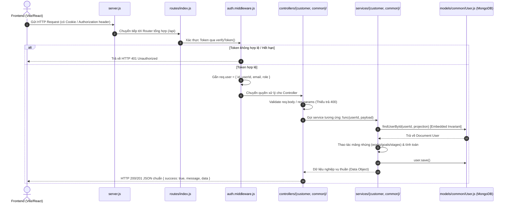

# HỆ THỐNG KIẾN TRÚC MÃ NGUỒN BACKEND (BACKEND ARCHITECTURE SYSTEMATIZATION)

Tài liệu này hệ thống hóa toàn bộ cấu trúc thư mục, luồng vận hành dữ liệu, quy chuẩn thiết kế và lý do kiến trúc phân tầng của thư mục [`backend/`](./) theo tiêu chuẩn **[arch-code-explainer](../.agents/skills/arch-code-explainer/SKILL.md)** và bộ quy tắc dự án [GEMINI.md](../GEMINI.md).

---

## TẦNG 1: BỨC TRANH TOÀN CẢNH (MACRO VIEW)

### 1. Triết Lý Thiết Kế & Cấu Trúc Đa Tầng (Layered Architecture)
Backend được xây dựng trên nền tảng **Node.js / Express** với kiến trúc phân tầng hướng dịch vụ (Layered Service-Oriented Architecture), áp dụng mô hình cơ sở dữ liệu **MongoDB Embedded Document**:

```text
backend/
├── server.js                      # Entrypoint: Khởi tạo Express, CORS, Middleware, Kết nối DB, Gắn Router
├── config/                        # Cấu hình môi trường, DB connection và Swagger Documentation
├── middlewares/                   # Bộ lọc xác thực JWT, bảo vệ Endpoint
├── routes/                        # Định tuyến API (Index -> Common / Customer)
├── controllers/                   # Tầng tiếp nhận HTTP Request, Validate, điều phối Response
├── services/                      # Tầng nghiệp vụ cốt lõi (Business Logic & Database Mutations)
└── models/                        # Định nghĩa Mongoose Schemas & MongoDB Embedded Structure
```

### 2. Sơ Đồ Luồng Dữ Liệu Toàn Cục (End-to-End Data Flow)



---

## TẦNG 2: QUY CHUẨN MÃ NGUỒN NỘI BỘ (DESIGN INVARIANTS)

Mã nguồn trong thư mục `backend/` tuân thủ nghiêm ngặt 3 quy chuẩn bất biến sau:

### 1. Chuẩn Bất Biến Tại Controller (`controllers/`)
* **Nhiệm vụ duy nhất:** Tiếp nhận `req, res`, giải nén `req.body`/`req.params`, kiểm tra tính đầy đủ đầu vào. Nếu thiếu trả về `400 Bad Request`.
* **Rút trích định danh:** Luôn lấy `userId = req.user.id || req.user._id` từ middleware xác thực, sau đó chuyển giao cho Service.
* **Không chứa truy vấn DB:** Tuyệt đối không import Mongoose Model hay viết câu lệnh query MongoDB trong file Controller.
* **Đóng gói Response chuẩn:** Mọi response trả về đều có dạng:
  ```json
  {
    "success": true,
    "message": "Thông báo thân thiện",
    "data": { ... }
  }
  ```
  Khối `catch (error)` trả về mã lỗi: `res.status(error.statusCode || 500).json({ success: false, message: error.message })`.

### 2. Chuẩn Bất Biến Tại Service (`services/`)
* **Tính độc lập tuyệt đối:** Các hàm Service chỉ nhận dữ liệu thuần qua tham số (ví dụ: `createWork(userId, workData)`) và trả về dữ liệu qua lệnh `return`. Không nhận hay trả về đối tượng `req, res` của Express.
* **Mô Hình MongoDB Embedded Invariant (Logic Tiêu Biểu):**
  Do hệ thống sử dụng kiến trúc tài liệu lồng nhau (Works, Goals, Stages, Dates nằm trực tiếp trong Collection `User`), **100% các hàm nghiệp vụ của Customer Service đều bắt đầu bằng hàm helper nội bộ:**
  ```javascript
  const user = await findUserById(userId, projection);
  ```
  *(Sử dụng `projection` để chỉ nạp đúng mảng cần thao tác như `works` hay `dates`, tối ưu hóa hiệu năng bộ nhớ RAM).*

### 3. Ranh Giới Phân Hệ (Strict Boundaries)
* **Phân hệ Common (`common/`):** Chứa các tác vụ dùng chung cho mọi đối tượng như Đăng ký, Đăng nhập, Token Refresh, Tích hợp trí tuệ nhân tạo Gemini (`auth`, `ai`).
* **Phân hệ Customer (`customer/`):** Chứa các dịch vụ chuyên biệt cho người dùng cuối quản lý kế hoạch học tập/công việc (`works`, `stages`, `goals`, `dates`, `dashboard`).
* Không có sự phụ thuộc chéo bất hợp lệ giữa các phân hệ; tất cả được điều phối tập trung qua Router tổng [`routes/index.js`](./routes/index.js).

---

## TẦNG 3: BẢNG PHÂN TÍCH NHÂN - QUẢ CÁC THƯ MỤC & FILE (ARCHITECTURAL RATIONALE)

### 1. Phân Tích Cấp Thư Mục

| Thư mục | Vai trò trong hệ thống | Đầu vào nhận từ đâu | Đầu ra chuyển tới đâu | Tại sao lại phân chia riêng? (Architectural Rationale) |
| :--- | :--- | :--- | :--- | :--- |
| [`config/`](./config) | Quản lý cấu hình hạ tầng | Biến môi trường `.env` | Cung cấp kết nối MongoDB cho `server.js`, tài liệu Swagger cho `/api-docs` | Cô lập cấu hình hạ tầng khỏi logic ứng dụng; thay đổi kết nối DB không làm sửa đổi mã nghiệp vụ. |
| [`middlewares/`](./middlewares) | Tầng phòng thủ & kiểm soát an ninh | HTTP Headers/Cookies từ Client | Gắn `req.user` cho Controllers | Tập trung hóa việc kiểm tra quyền và xác thực JWT tại 1 điểm duy nhất (DRY), bảo vệ các route private. |
| [`routes/`](./routes) | Bản đồ định tuyến HTTP URL | URL Path từ Client | Giao việc cho Controller tương ứng | Tách rời cấu trúc URL khỏi mã xử lý; cho phép đổi đường dẫn API mà không cần sửa logic hàm. |
| [`controllers/`](./controllers) | Tầng giao tiếp HTTP (Adapter) | `req` từ Route / Middleware | Gửi tham số vào Service, trả `res` JSON về Client | Đóng vai trò lớp chuyển đổi (Adapter): biến đổi dữ liệu từ giao thức HTTP thành dữ liệu thuần cho Service. |
| [`services/`](./services) | Trọng tâm nghiệp vụ (Domain Logic) | Dữ liệu thuần từ Controller | Thao tác Model và trả Object thuần cho Controller | Tái sử dụng được trong nhiều ngữ cảnh (REST API, CLI script, Background Worker) mà không bị phụ thuộc vào Express. |
| [`models/`](./models) | Khuôn mẫu dữ liệu (Schema Layer) | Lệnh thao tác từ Service | Truy vấn/Lưu trữ trực tiếp trên MongoDB | Đảm bảo tính toàn vẹn dữ liệu (Data Integrity), tự động validate kiểu dữ liệu, mã hóa mật khẩu trước khi lưu. |

---

### 2. Phân Tích Chi Tiết Các File Trọng Yếu

#### A. Nhóm Hạ Tầng & An Ninh
| Tên File | Phân hệ | Nhiệm vụ duy nhất | Đầu vào & Phụ thuộc | Đầu ra & Cung cấp | Tại sao tách riêng? |
| :--- | :--- | :--- | :--- | :--- | :--- |
| [`server.js`](./server.js) | Global | Khởi động máy chủ, cấu hình CORS & Server Lifecycles | `dotenv`, `config/db.js`, `routes/index.js` | Khởi chạy tiến trình lắng nghe trên cổng `PORT` (5000) | Giữ vai trò nhạc trưởng (Bootstrap Orchestrator) duy nhất, không chứa bất kỳ logic API cụ thể nào. |
| [`config/db.js`](./config/db.js) | Common | Thiết lập và quản lý vòng đời kết nối Mongoose | `MONGO_URI` từ file môi trường | Trạng thái kết nối (`getDBStatus()`) | Cô lập cơ chế kết nối có retry và giám sát ngắt kết nối an toàn (Graceful Shutdown). |
| [`middlewares/auth.middleware.js`](./middlewares/auth.middleware.js) | Common | Giải mã JWT từ Cookie/Bearer và chặn request không hợp lệ | Header `Authorization` hoặc Cookie `token` | Gắn `req.user` hoặc trả mã 401 | Tách biệt hoàn toàn tầng an ninh, không để logic giải mã token nằm rải rác ở từng Controller. |

#### B. Nhóm Xác Thực & Người Dùng (Auth & User)
| Tên File | Phân hệ | Nhiệm vụ duy nhất | Đầu vào & Phụ thuộc | Đầu ra & Cung cấp | Tại sao tách riêng? |
| :--- | :--- | :--- | :--- | :--- | :--- |
| [`models/common/User.js`](./models/common/User.js) | Common | Định nghĩa cấu trúc User và toàn bộ Subdocument nhúng (`works`, `goals`, `stages`, `dates`) | `mongoose`, `Counter.js` | Model `User` toàn hệ thống | Sử dụng thiết kế Embedded Document để gom toàn bộ dữ liệu 1 người dùng vào 1 tài liệu, tăng tốc độ truy vấn đọc/ghi mà không cần Join nhiều bảng. |
| [`controllers/common/auth.controller.js`](./controllers/common/auth.controller.js) | Common | Nhận request đăng ký, đăng nhập, cấp và hủy Cookie | `req.body` (email, username, password) | Set Cookie `token` và trả User info | Chỉ lo việc giao tiếp HTTP, gán cookie an toàn `httpOnly`, `sameSite`. |
| [`services/common/auth.service.js`](./services/common/auth.service.js) | Common | Kiểm tra mật khẩu (Bcrypt), sinh JWT Token và tạo User mới | Email, Username, Password thuần | Object User đã ẩn mật khẩu + JWT Token | Tách độc lập logic băm mật khẩu và ký JWT để dễ dàng viết Unit Test kiểm thử xác thực. |

#### C. Nhóm Nghiệp Vụ Khách Hàng (Customer Work Management)
| Tên File | Phân hệ | Nhiệm vụ duy nhất | Đầu vào & Phụ thuộc | Đầu ra & Cung cấp | Tại sao tách riêng? |
| :--- | :--- | :--- | :--- | :--- | :--- |
| [`services/customer/work.service.js`](./services/customer/work.service.js) | Customer | Thao tác CRUD trên mảng nhúng `user.works` | `userId`, `workData` $\to$ gọi `models/User.js` | Dữ liệu đầu việc kèm tiến độ tính toán (`progress_percentage`) | Trọng tâm quản lý đầu việc lớn, tính toán số mục tiêu hoàn thành trước khi trả về cho UI. |
| [`services/customer/stage.service.js`](./services/customer/stage.service.js) | Customer | Quản lý các chặng / giai đoạn con của đầu việc | `userId`, `workId`, `stageData` | Dữ liệu chặng đã cập nhật | Tách riêng khỏi work để không làm phình to file `work.service.js`, chuyên trách việc đổi vị trí/thời hạn chặng. |
| [`services/customer/goal.service.js`](./services/customer/goal.service.js) | Customer | Quản lý checklist mục tiêu con của đầu việc | `userId`, `workId`, `goalData` | Dữ liệu mục tiêu đã cập nhật | Chịu trách nhiệm cập nhật trạng thái `is_completed` và tự động kích hoạt tính toán lại tỷ lệ tiến độ của đầu việc cha. |
| [`services/customer/date.service.js`](./services/customer/date.service.js) | Customer | Quản lý các ngày quan trọng, lịch thi, sự kiện | `userId`, `dateData` | Danh sách sự kiện lịch trình | Phục vụ tính năng đếm ngược ngày quan trọng trên giao diện mà không làm xáo trộn dữ liệu công việc. |
| [`services/customer/dashboard.service.js`](./services/customer/dashboard.service.js) | Customer | Tổng hợp chỉ số thống kê tổng quan và truy xuất lịch sử mục tiêu đã hoàn thành | `userId` $\to$ đọc `works`, `dates` của User | Object dữ liệu tổng quan (`upcoming_goals`, `upcoming_dates`) và mảng lịch sử (`getCompletedGoalsHistory`) | Phục vụ đọc nhanh (Read-heavy aggregation) cho trang chủ và cung cấp dữ liệu cho tính năng hoàn tác mục tiêu bấm nhầm (`GET /api/dashboard/history`). |
| [`controllers/customer/dashboard.controller.js`](./controllers/customer/dashboard.controller.js) | Customer | Tiếp nhận HTTP request cho tổng quan Dashboard và lịch sử hoàn thành | `req.user.id`, `req.query.limit` | Response JSON `{ success: true, data }` | Đóng vai trò adapter chuẩn hóa dữ liệu, bóc tách `limit` phân trang và điều phối gọi `dashboard.service.js`. |

#### D. Nhóm Trí Tuệ Nhân Tạo (AI Service)
| Tên File | Phân hệ | Nhiệm vụ duy nhất | Đầu vào & Phụ thuộc | Đầu ra & Cung cấp | Tại sao tách riêng? |
| :--- | :--- | :--- | :--- | :--- | :--- |
| [`services/common/ai.service.js`](./services/common/ai.service.js) | Common | Kết nối Google Gemini API để phân tích và sinh lộ trình học | User prompt, lịch trình hiện tại của User | JSON cấu trúc lộ trình gồm Works, Stages, Goals gợi ý | Cô lập các prompt kỹ thuật AI và các lệnh gọi bên thứ ba; nếu đổi model AI chỉ cần cập nhật tại file này. |

---

## TỔNG KẾT & ĐÁNH GIÁ CHUẨN MỰC

1. **Tính Nhất Quán (Consistency):**
   - 100% các file đều có khối chú thích đầu file (**File Header**) xác định rõ Tên file, Công dụng và Phạm vi dùng.
   - Các hàm đều tuân thủ việc nhận dữ liệu qua tham số và trả về qua `return`, không sử dụng biến toàn cục.
2. **Khả Năng Mở Rộng (Scalability):**
   - Cấu trúc `common/` và `customer/` hiện tại đã sẵn sàng để bổ sung thư mục `admin/` (ví dụ: `controllers/admin/`, `services/admin/`) mà không làm ảnh hưởng đến bất kỳ code khách hàng nào đang chạy.
   - Sẵn sàng tích hợp Swagger UI tại [`/api-docs`](./config/swagger.js) giúp tài liệu hóa toàn diện các endpoint.
