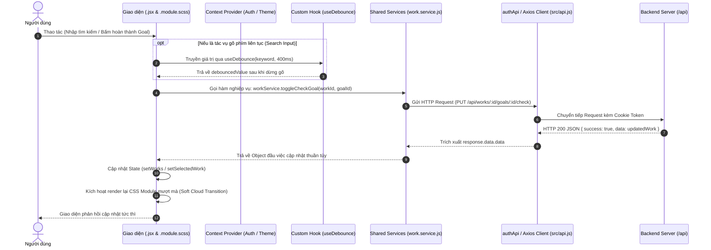

# HỆ THỐNG KIẾN TRÚC MÃ NGUỒN FRONTEND (FRONTEND ARCHITECTURE SYSTEMATIZATION)

Tài liệu này hệ thống hóa toàn bộ cấu trúc thư mục, phân tầng giao diện, luồng vận hành dữ liệu, quy chuẩn thiết kế và lý do kiến trúc của thư mục [`frontend/`](./) theo tiêu chuẩn **[arch-code-explainer](../.agents/skills/arch-code-explainer/SKILL.md)** và bộ quy tắc dự án [GEMINI.md](../GEMINI.md).

---

## TẦNG 1: BỨC TRANH TOÀN CẢNH (MACRO VIEW)

### 1. Triết Lý Thiết Kế & Cấu Trúc Đa Tầng (Layered Atomic Architecture)
Frontend được xây dựng bằng **React (Vite)** với ngôn ngữ **JavaScript thuần (`.jsx`, `.js`)**, định dạng kiểu dáng 100% bằng **SCSS Modules (`.module.scss`)** theo phong cách **Soft Cloud UI**. Hệ thống được phân cấp rạch ròi theo 4 tầng trách nhiệm:

```text
frontend/
├── index.html                     # HTML Template gốc, gắn thẻ font và container #root
├── vite.config.js                 # Cấu hình Vite, SCSS preprocessor và Dev Server Proxy
└── src/
    ├── main.jsx                   # Khởi tạo React Root, nạp global.scss và nạp App
    ├── app/                       # [CẤP 0] Khung xương toàn cục (Global Shell)
    │   ├── App.jsx                # Bộ điều hướng trung tâm (Dashboard, WorkView, CalendarView)
    │   ├── App.module.scss        # Bố cục khung hiển thị toàn màn hình
    │   ├── providers/             # Context Providers toàn cục (AuthContext, ThemeContext)
    │   └── styles/                # Tokens, Mixins và Global Reset SCSS
    │
    ├── components/                # [CẤP 1] Giao diện dùng chung ở nhiều màn hình (Header, SnakeGame)
    ├── common/                    # [CẤP 1] Màn hình/tính năng chung cho mọi đối tượng (AuthModal)
    ├── customer/                  # [CẤP 1] Toàn bộ tính năng DÀNH RIÊNG cho Khách hàng
    │   ├── Dashboard/             # Giao diện 1: Tổng quan chỉ số, việc gấp, đếm ngược sự kiện
    │   ├── WorkView/              # Giao diện 2: Quản lý đầu việc, giai đoạn và mục tiêu chi tiết
    │   │   └── components/        # Subcomponents cục bộ (StageAccordion, Modals, AIRoadmap)
    │   └── CalendarView/          # Giao diện 3: Lịch tháng trực quan, đếm ngược ngày quan trọng
    │
    └── shared/                    # [CẤP 2] Logic thuần không có giao diện
        ├── hooks/                 # Custom Hooks dùng chung (useDebounce)
        ├── services/              # Đóng gói gọi API (auth, work, stage, ai, email)
        └── utils/                 # Hàm tiện ích thuần túy (dateFormat)
```

---

### 2. Sơ Đồ Luồng Dữ Liệu Toàn Cục (End-to-End Component Data Flow)



---

## TẦNG 2: QUY CHUẨN MÃ NGUỒN NỘI BỘ (DESIGN INVARIANTS)

Frontend tuân thủ nghiêm ngặt 4 quy chuẩn bất biến theo [GEMINI.md](../GEMINI.md):

### 1. Chuẩn Bất Biến Tại Component (`.jsx`)
* **Tách Biệt Trách Nhiệm (Separation of Concerns):** Tuyệt đối **KHÔNG** gọi `fetch` hay `axios` trực tiếp trong file `.jsx`. Mọi tương tác mạng bắt buộc phải đi qua các hàm trong `src/shared/services/`.
* **Cấu Trúc Thư Mục Component Khép Kín:** Mỗi component hoặc màn hình đều nằm trong một thư mục riêng biệt gồm 3 file tiêu chuẩn:
  - `[Name].jsx`: Chứa JSX markup và logic hiển thị cục bộ.
  - `[Name].module.scss`: Định kiểu dáng cục bộ với SCSS Modules, cô lập namespace class.
  - `index.js`: Điểm xuất khẩu ngắn gọn (`export { default } from './[Name].jsx'`).
* **JavaScript Thuần Túy:** 100% sử dụng `.jsx`, `.js`. Không sử dụng cú pháp TypeScript.

### 2. Chuẩn Bất Biến Về Giao Diện (Styling & Theme Invariants)
* **100% SCSS Modules:** Không viết inline style `style={{ ... }}`. Không sử dụng các class utility của Tailwind.
* **Phong Cách Soft Cloud UI:**
  - Sử dụng hệ màu biến CSS tại `src/app/styles/_variables.scss` (`$color-primary`, `$color-surface`, `$color-bg`).
  - Hiệu ứng kính mờ (Frosted Glass) với `backdrop-filter: blur(12px)`.
  - Hiệu ứng chuyển động mượt mà với đường cong gia tốc `cubic-bezier(0.22, 1, 0.36, 1)`, thời lượng `180ms - 260ms`.

### 3. Chuẩn Bất Biến Tại Tầng Service (`src/shared/services/`)
* **Hàm Thuần (Pure Functions):** Mỗi hàm service nhận dữ liệu qua tham số và trả về dữ liệu thuần qua lệnh `return response.data.data`.
* **Cơ Chế Token & Credentials:** Mọi request được gắn `withCredentials: true` và tự động gắn Bearer Token qua Axios Interceptor trong `auth.service.js`.

### 4. Ranh Giới Phân Hệ (Strict Boundaries)
* Phân hệ `customer/` và `admin/` độc lập tuyệt đối, không được import chéo mã nguồn của nhau.
* Các logic và giao diện dùng chung bắt buộc phải đặt tại `components/`, `common/` hoặc `shared/`.

---

## TẦNG 3: BẢNG PHÂN TÍCH NHÂN - QUẢ CÁC THƯ MỤC & FILE (ARCHITECTURAL RATIONALE)

### 1. Phân Tích Cấp Thư Mục

| Thư mục | Vai trò trong hệ thống | Đầu vào nhận từ đâu | Đầu ra chuyển tới đâu | Tại sao lại phân chia riêng? (Architectural Rationale) |
| :--- | :--- | :--- | :--- | :--- |
| [`src/app/`](./src/app) | Khung xương ứng dụng (Cấp 0) | `main.jsx` | Bọc toàn bộ các view con bên trong Layout | Quản lý state điều hướng toàn cục và các Context Provider (Auth, Theme) tại 1 vị trí trung tâm duy nhất. |
| [`src/app/styles/`](./src/app/styles) | Hệ thống Design System | Thiết kế Soft Cloud | Cung cấp biến và mixin cho các file `.module.scss` | Tập trung hóa bảng màu, breakpoint responsive và reset CSS; đổi theme chỉ cần sửa tại 1 điểm. |
| [`src/components/`](./src/components) | UI dùng chung (Cấp 1) | Props từ `App.jsx` hoặc các Views | Render Header, Mini Game | Tái sử dụng các khối giao diện ở bất kỳ trang nào mà không phụ thuộc vào nghiệp vụ cụ thể. |
| [`src/common/`](./src/common) | Màn hình dùng chung mọi đối tượng | Sự kiện đăng nhập / đăng ký | Xác thực phiên và cấp quyền | Tập trung hóa hộp thoại xác thực (Login, Register OTP, Forgot Password) cho mọi phân hệ. |
| [`src/customer/`](./src/customer) | Phân hệ Khách hàng (Cấp 1) | Dữ liệu từ Service và State người dùng | Hiển thị 3 màn hình nghiệp vụ chính | Cô lập nghiệp vụ của người dùng cuối, đảm bảo không bị xáo trộn khi dự án mở rộng thêm phân hệ `admin/`. |
| [`src/shared/services/`](./src/shared/services) | Lớp giao tiếp API (Data Layer) | Lời gọi từ React Components | Gửi request tới Backend và trả dữ liệu sạch | Tách rời tầng hiển thị khỏi giao thức HTTP; thay đổi endpoint Backend chỉ cần sửa tại Service. |
| [`src/shared/hooks/`](./src/shared/hooks) | Logic tái sử dụng (Logic Layer) | Sự kiện giao diện (Input...) | Cung cấp trạng thái debounced / device | Tái sử dụng logic phức tạp giữa nhiều component mà không làm lặp mã. |
| [`src/shared/utils/`](./src/shared/utils) | Tiện ích thuần túy (Helpers) | Chuỗi ngày tháng, số liệu | Trả về chuỗi format, badge | Hàm tính toán không có side-effect, dễ viết Unit Test độc lập. |

---

### 2. Phân Tích Chi Tiết Các File Trọng Yếu

#### A. Khung Toàn Cục & Khởi Động
| Tên File | Phân hệ | Nhiệm vụ duy nhất | Đầu vào & Phụ thuộc | Đầu ra & Cung cấp | Tại sao tách riêng? |
| :--- | :--- | :--- | :--- | :--- | :--- |
| [`src/main.jsx`](./src/main.jsx) | Global | Khởi tạo DOM Root và nạp StrictMode | `react-dom/client`, `global.scss`, `App.jsx` | Gắn ứng dụng React vào `<div id="root">` | Đóng vai trò bootstrap sạch sẽ, không chứa logic giao diện hay state. |
| [`src/app/App.jsx`](./src/app/App.jsx) | Cấp 0 | Điều phối 3 màn hình chính (`dashboard`, `works`, `calendar`) và Modal Auth | `AuthContext`, `ThemeContext`, `Header`, `AuthModal` | Bố cục Layout khung xương của toàn bộ ứng dụng | Đóng vai trò Router nội bộ, quản lý chuyển tab và đồng bộ trạng thái giữa Dashboard và WorkView. |
| [`src/app/providers/AuthContext.jsx`](./src/app/providers/AuthContext.jsx) | Cấp 0 | Quản lý phiên đăng nhập toàn cục và cơ chế tự động khôi phục từ Cookie | `shared/services/auth.service.js` | `useAuth()` Hook cung cấp `{ user, login, logout, checkAuthStatus }` | Tránh hiện tượng prop drilling, cho phép mọi component con kiểm tra trạng thái đăng nhập tức thì. |
| [`src/app/providers/ThemeContext.jsx`](./src/app/providers/ThemeContext.jsx) | Cấp 0 | Quản lý chế độ hiển thị Sáng/Tối (Light/Dark) | `localStorage`, DOM attribute `data-theme` | `useTheme()` Hook cung cấp `{ theme, toggleTheme }` | Gắn theme lên thẻ `<html>` hoặc `<body>` giúp toàn bộ SCSS Modules tự động cập nhật biến màu. |

#### B. Phân Hệ Khách Hàng (Customer Views)
| Tên File | Phân hệ | Nhiệm vụ duy nhất | Đầu vào & Phụ thuộc | Đầu ra & Cung cấp | Tại sao tách riêng? |
| :--- | :--- | :--- | :--- | :--- | :--- |
| [`customer/Dashboard/Dashboard.jsx`](./src/customer/Dashboard/Dashboard.jsx) | Customer | Hiển thị bảng điều khiển tổng quan: thống kê tiến độ, đếm ngược sự kiện và danh sách việc gấp | `shared/services/work.service.js`, `dateFormat.js` | Giao diện tổng hợp nhanh cho trang chủ | Tập trung vào đọc dữ liệu tổng quan; cung cấp nút tắt điều hướng sang chi tiết WorkView. |
| [`customer/WorkView/WorkView.jsx`](./src/customer/WorkView/WorkView.jsx) | Customer | Quản lý toàn bộ vòng đời đầu việc (CRUD Work, Stage, Goal) và tích hợp trợ lý AI | `work.service.js`, `stage.service.js`, `useDebounce`, subcomponents | Giao diện quản lý tiến độ cốt lõi | Màn hình trọng tâm nhất của hệ thống; chia nhỏ thành các modal và accordion con để tối ưu render. |
| [`customer/CalendarView/CalendarView.jsx`](./src/customer/CalendarView/CalendarView.jsx) | Customer | Hiển thị ma trận lịch tháng trực quan, đánh dấu các ngày thi cử và sự kiện | `work.service.js` (fetchDates) | Giao diện lịch biểu và đếm ngược | Chuyên trách biểu diễn dữ liệu theo trục thời gian tháng, độc lập khỏi giao diện danh sách công việc. |

#### C. Các Subcomponents Thuộc WorkView
| Tên File | Phân hệ | Nhiệm vụ duy nhất | Đầu vào & Phụ thuộc | Đầu ra & Cung cấp | Tại sao tách riêng? |
| :--- | :--- | :--- | :--- | :--- | :--- |
| [`WorkView/components/StageAccordion`](./src/customer/WorkView/components/StageAccordion/StageAccordion.jsx) | Customer | Hiển thị danh sách các chặng theo dạng Accordion gấp mở, chứa các Goal con | Danh sách Stages và Goals của Work | Khung hiển thị trực quan các giai đoạn | Tách khỏi `WorkView.jsx` để tránh phình to file và dễ dàng tái sử dụng cho từng Work khác nhau. |
| [`WorkView/components/GoalModal`](./src/customer/WorkView/components/GoalModal/GoalModal.jsx) | Customer | Hộp thoại tạo mới hoặc chỉnh sửa mục tiêu con | Form input (tên goal, hạn chặng, ưu tiên) | Gọi `createGoal` hoặc `updateGoal` | Cô lập logic validate form nhập liệu của mục tiêu con. |
| [`WorkView/components/StageModal`](./src/customer/WorkView/components/StageModal/StageModal.jsx) | Customer | Hộp thoại tạo mới hoặc cấu hình màu sắc/thời hạn cho chặng | Form input (tên chặng, start/end date, color) | Gọi `createStage` hoặc `updateStage` | Cô lập form cấu hình chặng của đồ án. |
| [`WorkView/components/AIRoadmapModal`](./src/customer/WorkView/components/AIRoadmapModal/AIRoadmapModal.jsx) | Customer | Hộp thoại tương tác với Gemini AI để sinh lộ trình tự động | User prompt, `shared/services/ai.service.js` | Hiển thị lộ trình AI gợi ý và cho phép người dùng áp dụng | Tách biệt tính năng AI khỏi luồng tạo việc thủ công. |

#### D. Tầng Shared Services & Helpers
| Tên File | Phân hệ | Nhiệm vụ duy nhất | Đầu vào & Phụ thuộc | Đầu ra & Cung cấp | Tại sao tách riêng? |
| :--- | :--- | :--- | :--- | :--- | :--- |
| [`shared/services/auth.service.js`](./src/shared/services/auth.service.js) | Shared | Cấu hình Axios instance `authApi` và các API đăng ký, đăng nhập, refresh token | `src/api.js`, Backend API `/api/auth` | Dữ liệu phiên đăng nhập và interceptor tự động | Quản lý xác thực tập trung, tự động chặn mã 401 để xử lý đăng xuất an toàn. |
| [`shared/services/work.service.js`](./src/shared/services/work.service.js) | Shared | Đóng gói toàn bộ 10 API nghiệp vụ (Works, Goals, Dates, Dashboard) | `authApi` | Các hàm `fetchWorks`, `createWork`, `toggleCheckGoal`... | Đầu mối duy nhất cho việc gọi dữ liệu công việc; component chỉ cần import hàm cần dùng. |
| [`shared/services/email.service.js`](./src/shared/services/email.service.js) | Shared | Tích hợp thư viện EmailJS để gửi mã OTP xác thực qua email thực tế | EmailJS SDK, biến môi trường `VITE_EMAILJS_*` | Trạng thái gửi email | Cô lập thư viện bên thứ ba; có chế độ Dev Mode tự động khi chưa cấu hình key. |
| [`shared/hooks/useDebounce.js`](./src/shared/hooks/useDebounce.js) | Shared | Trì hoãn cập nhật giá trị trong một khoảng thời gian (delay) | `value`, `delay` (ms) | `debouncedValue` | Chống spam API khi người dùng gõ vào ô tìm kiếm (Search Input). |
| [`shared/utils/dateFormat.js`](./src/shared/utils/dateFormat.js) | Shared | Chuyển đổi định dạng ngày tháng hiển thị và tính toán badge hạn nộp | Chuỗi ISO Date | Chuỗi ngày định dạng VN (`DD/MM/YYYY`) và thông tin hạn nộp | Chuẩn hóa hiển thị thời gian trên toàn ứng dụng. |

---

## PHỤ LỤC: HƯỚNG DẪN CẤU HÌNH DỊCH VỤ EMAILJS (OTP VERIFICATION)

Để kích hoạt tính năng gửi email xác thực mã OTP thực tế tới hòm thư người dùng khi đăng ký tài khoản:

### 1. Các bước thiết lập trên trang EmailJS:
1. Truy cập [https://www.emailjs.com/](https://www.emailjs.com/) và đăng ký tài khoản miễn phí.
2. **Tạo Service:** Vào **Email Services** $\rightarrow$ **Add New Service** $\rightarrow$ Kết nối hòm thư Gmail/Outlook $\rightarrow$ Lấy `Service ID`.
3. **Tạo Template:** Vào **Email Templates** $\rightarrow$ **Create New Template** với nội dung:
   - **To Email:** `{{to_email}}`
   - **Subject:** `Mã xác thực đăng ký tài khoản của bạn: {{otp_code}}`
   - **Body:** `Mã xác thực OTP của bạn là {{otp_code}}, có hiệu lực trong {{expiry_minutes}} phút.`
   - Lưu và lấy `Template ID`.
4. **Lấy API Key:** Vào **Account** $\rightarrow$ **API Keys** $\rightarrow$ Sao chép chuỗi `Public Key`.

### 2. Cài đặt biến môi trường:
Tạo hoặc bổ sung vào tệp `frontend/.env`:
```env
VITE_API_URL=http://localhost:5000
VITE_EMAILJS_SERVICE_ID=service_xxxxxxx
VITE_EMAILJS_TEMPLATE_ID=template_xxxxxxx
VITE_EMAILJS_PUBLIC_KEY=user_xxxxxxxxxxxx
```
> [!NOTE]
> Nếu chưa điền các biến trên, hệ thống sẽ tự động chuyển sang **Chế độ Thử nghiệm (Dev Mode)**: mã OTP được in trực tiếp lên giao diện và console để phục vụ kiểm thử nhanh chóng.
